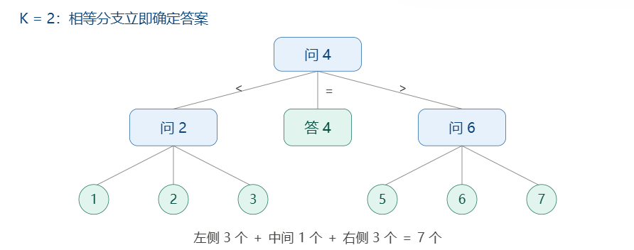

## 题目概述

猜数游戏。对每局游戏，交互库预先固定一个秘密数 $x\in[1,N]$。我们可以询问至多 $K$ 次，每次提交一个数，并得到 `<`、`>` 或 `=` 的比较结果；询问结束后再输出最终猜测，这一步不计入询问次数。令 $P(x)$ 表示秘密数固定为 $x$ 时，程序**凭自身随机性**猜中它的概率。目标是最大化最坏情况下的胜率：

$$
\min_{1\le x\le N}P(x)
$$

原题还包含多轮测试、并行游戏及 $0.01$ 的评分容差；下面先讨论一局游戏的理论最优策略，代码再处理完整的交互协议。

## 解题思路

令 $k=2^{K+1}-1$，并记 $m=\min(N,k)$。当 $k\ge N$ 时，直接在全部 $N$ 个数上二分即可必胜；以下主要解释 $k<N$ 的情形，最终实现同时适用于两种情况。

### 观察一：一份确定性策略最多猜对 $k$ 个秘密数

把一次询问画成决策树：收到 `=` 时，秘密数已经确定，这条分支只对应一个数；收到 `<` 或 `>` 时，分别进入剩余次数少一次的子树。树中**能够对应不同正确答案的有效叶子**至多有 $k$ 个。图中 $K=2$，左右子树各有 $3$ 个，中间等号分支有 $1$ 个，共 $7$ 个。最后一次询问没有猜中时，仍然可以利用不计入询问次数的最终猜测。



这里的“叶子数”是上界，而非说每棵三叉决策树都恰有 $k$ 个叶子。对随机策略，同样有

$$
\sum_{x=1}^{N}P(x)\le k
$$

<details>
<summary>展开严格证明（含随机策略）</summary>

先只考虑确定性策略。令 $F(t)$ 为所有还允许询问至多 $t$ 次的确定性策略中，能够猜对的不同秘密数数量的最大值。由于最终猜测不计入询问次数，$t=0$ 时只能直接猜一个数，故 $F(0)\le1$。

若 $t>0$，第一次询问 $y$：结果为 `=` 只可能对应 $x=y$，至多贡献 $1$ 个能猜对的数；结果为 `<` 或 `>` 的两条分支各剩 $t-1$ 次询问，分别至多贡献 $F(t-1)$ 个。因此

$$
F(t)\le 2F(t-1)+1\le 2^{t+1}-1
$$

现在恢复随机性。预先固定程序在一局中可能使用的全部随机结果 $\omega$，它就变成一份确定性策略。设 $I_\omega(x)$ 表示秘密数为 $x$ 时，这份策略是否猜对（猜对为 $1$，否则为 $0$）。对每个 $\omega$，都有

$$
\sum_{x=1}^{N}I_\omega(x)\le 2^{K+1}-1=k
$$

随机结果与秘密数无关，故 $P(x)=\mathbb{E}_\omega[I_\omega(x)]$。对上式取期望，交换有限求和与期望，即得

$$
\begin{aligned}
\sum_{x=1}^{N}P(x)
&=\sum_{x=1}^{N}\mathbb{E}_\omega[I_\omega(x)]\\
&=\mathbb{E}_\omega\!\left[\sum_{x=1}^{N}I_\omega(x)\right]\\
&\le k
\end{aligned}
$$

</details>

这个上界可以取到：只要选出 $k$ 个数，并在其上按中位数二分，便能在 $K$ 次询问和最后一次猜测中覆盖这 $k$ 个数（前提是 $k<N$）。

### 观察二：最优策略应平均分配胜率

对任意策略，最小值不超过平均值，而每个 $P(x)\le1$，于是

$$
\min_{1\le x\le N}P(x)
\le\min\!\left(1,\frac{1}{N}\sum_{x=1}^{N}P(x)\right)
\le\frac{m}{N}
$$

当 $k<N$ 时，若使所有 $P(x)=k/N$，便恰好达到上界；反过来，要达到这一上界，也必须使它们全部相等。当 $k\ge N$ 时，目标变为对所有数必胜。

### 观察三：随机选取一个长度为 $m$ 的循环窗口

先固定大小为 $m$ 的子集 $T\subseteq[1,N]$。把 $T$ 中的数从小到大排序，每次询问当前候选数的中位数；若结果为 `=` 则已经知道答案，其他两条分支继续二分。由于 $m\le2^{K+1}-1$，当 $x\in T$ 时，最终必定猜中；当 $x\notin T$ 时，我们始终只输出 $T$ 中的数。因此这份确定性策略满足

$$
P_T(x)=\begin{cases}
1,&x\in T,\\
0,&x\notin T
\end{cases}
$$

为了让每个数被覆盖的概率相同，从 $1$ 到 $N$ **均匀随机**选取一个起点 $a$，在环上从 $a$ 起连续取 $m$ 个数，得到窗口

$$
T_a=\bigl\{((a+j-2)\bmod N)+1\mid 1\le j\le m\bigr\}
$$

每个 $x$ 恰好出现在 $N$ 种窗口中的 $m$ 种里，所以

$$
P(x)=\Pr(x\in T_a)=\frac{m}{N},\qquad
\mathrm{OPT}=\frac{m}{N}=\min\!\left(1,\frac{2^{K+1}-1}{N}\right)
$$

## 实现

赛场上，我用 `mid(st, N, k, L, R)` 求窗口与 $[L,R]$ 的交集的中位数，并据 `<`、`>` 更新边界。这里复现的代码改用窗口内**从小到大的下标** $r$ 来二分，省去了对数值区间的分类讨论。

令 $w=\max(0,a+m-1-N)$，即窗口回绕到 $1$ 后的那部分的长度。若 $w=0$，排序后的窗口是 $[a,a+m-1]$；否则是 $[1,w]$ 与 $[a,N]$ 依次拼接。因此从 $0$ 开始计数，第 $r$ 个数可以直接算出：

$$
\operatorname{value\_at}(a,r)=
\begin{cases}
r+1,&r<w,\\
a+r-w,&r\ge w
\end{cases}
$$

每局游戏独立随机选起点；每次输出当前下标区间的中位数，读取反馈后缩小区间，完成 $K$ 次询问后输出唯一剩下的数。无需创建大小为 $N$ 的数组，处理 $B$ 轮、每轮 $S$ 局的总复杂度为 $O(BSK)$ 时间、$O(S)$ 空间。

比赛时第一次提交就通过了此题，因此没有打印保存原代码。下面的 C++17 实现由 LLM 依据题解复现，随后针对每个固定秘密数模拟交互并核验最坏胜率；`value_at` 比当时的 `mid` 写法更简洁。

```cpp
#include <bits/stdc++.h>
using namespace std;
using i64 = long long;

mt19937_64 rng(chrono::steady_clock::now().time_since_epoch().count());

// Uniform in [1, n]. Rejecting a tiny prefix avoids modulo bias.
i64 random_start(i64 n) {
    uint64_t reject = -uint64_t(n) % n;
    uint64_t v;
    do v = rng(); while (v < reject);
    return i64(v % n) + 1;
}

// Sorted cyclic window; rank is zero-based.
i64 value_at(i64 start, i64 n, i64 len, i64 rank) {
    i64 wrapped = max(0LL, start + len - 1 - n);
    return rank < wrapped ? rank + 1 : start + rank - wrapped;
}

int main() {
    ios::sync_with_stdio(false);
    cin.tie(nullptr);

    i64 n;
    int k, b, s;
    if (!(cin >> n >> k >> b >> s)) return 0;
    i64 len = min(n, (1LL << (k + 1)) - 1);
    vector<i64> start(s), lo(s), hi(s), mid(s);

    for (int round = 0; round < b; ++round) {
        for (int i = 0; i < s; ++i) {
            start[i] = len == n ? 1 : random_start(n);
            lo[i] = 0;
            hi[i] = len - 1;
        }

        for (int step = 0; step < k; ++step) {
            for (int i = 0; i < s; ++i) {
                mid[i] = (lo[i] + hi[i]) / 2;
                if (i) cout << ' ';
                cout << value_at(start[i], n, len, mid[i]);
            }
            cout << endl;

            string reply;
            if (!(cin >> reply) || int(reply.size()) != s) return 0;
            for (int i = 0; i < s; ++i) {
                if (reply[i] == '<') hi[i] = mid[i] - 1;
                else if (reply[i] == '>') lo[i] = mid[i] + 1;
                else if (reply[i] == '=') lo[i] = hi[i] = mid[i];
                else return 0;
            }
        }

        for (int i = 0; i < s; ++i) {
            if (i) cout << ' ';
            cout << value_at(start[i], n, len, lo[i]);
        }
        cout << endl;
    }
    return 0;
}
```
